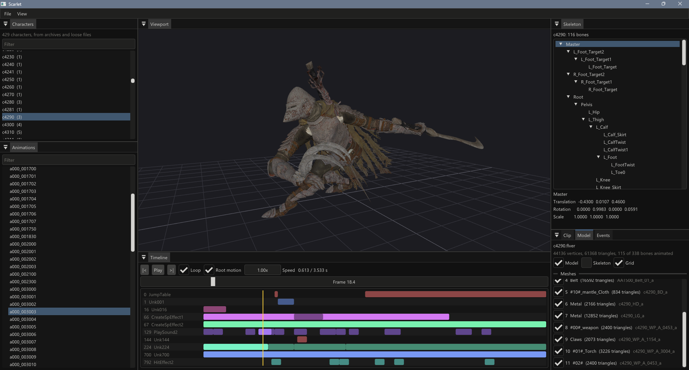

# Scarlet

**Scarlet** is an open-source animation viewer and (soon) editor for ELDEN RING, built on
[libSouls](https://github.com/jakerieger/libSouls). It is an independent, from-scratch alternative to existing animation
tools, not a port of any of them.

It reads the game directly: point it at your game folder and it reads characters and animations from the game's packed
archives, or from loose files if you've unpacked the game or are working on a mod.



## Features

- Every character's skeleton and animations, straight from the game's archives (no unpacking needed) or loose files.
- Playback of every animation in the game (Havok spline-compressed and uncompressed), including additive animations
  and root motion.
- The character's model, skinned to the animated skeleton and textured with its albedo maps (from the game's
  materials), with each mesh's visibility toggleable.
- Timeline: play/pause, scrubbing, frame stepping, looping and playback speed.
- The animation's events (TAE) on the timeline, one track per event type, with an inspector for each event's fields.
- Skeleton hierarchy with each bone's local transform at the playhead, and the selected bone highlighted in the
  viewport.
- Orbit camera: left or right drag to orbit, middle drag to pan, wheel to zoom, F to frame the character.
- Editing: pose a bone at a frame to key an offset (rotation and translation) layered over the animation;
  keys interpolate between frames, show on the timeline, and can be undone and redone. Click a joint in the
  viewport to select its bone.
- Saving: edited animations are written into their animation binders in a mod folder (the `chr` folder of a
  Mod Engine 2 mod), keeping any other changes already saved there.

Keyboard: Space plays/pauses, Left/Right step a frame, F frames the character, Ctrl+S saves edits, Ctrl+Z/Ctrl+Y
undo and redo.

## Roadmap

- The player character's body, assembled from equipment parts.
- Named, decoded fields for Elden Ring's event types (for now they're shown as raw values).
- Normal maps and the rest of each material.
- Editing tools: a rotate/move gizmo in the viewport, curve editing, and root motion editing.

## Building

Requirements: Windows, MSVC (Visual Studio 2022 or later), CMake 3.26+ and Ninja. Run the commands from a VS Developer
PowerShell.

```shell
git clone --recurse-submodules https://github.com/jakerieger/Scarlet
cd Scarlet
cmake --preset debug      # or release
cmake --build --preset debug
```

The executable is `build/<preset>/bin/Scarlet.exe`, next to `Souls.dll` and the `BinderKeys` folder it needs to read
the game's archives. On first launch, choose the game folder (the one with `eldenring.exe`) with **File > Open Game
Folder**. Scarlet uses the game's own `oo2core_6_win64.dll` to decompress files.

### Working on libSouls at the same time

libSouls is fetched at a pinned commit. To build against a local checkout instead, add a `CMakeUserPresets.json`
(git-ignored) that sets `FETCHCONTENT_SOURCE_DIR_LIBSOULS`:

```json
{
  "version": 6,
  "configurePresets": [
    {
      "name": "local-debug",
      "inherits": "debug",
      "cacheVariables": {
        "FETCHCONTENT_SOURCE_DIR_LIBSOULS": "C:/path/to/libSouls"
      }
    }
  ],
  "buildPresets": [
    {
      "name": "local-debug",
      "configurePreset": "local-debug"
    }
  ]
}
```

## Acknowledgements

- [**libSouls**](https://github.com/jakerieger/libSouls) and everything it builds on, notably
  [SoulsFormats](https://github.com/JKAnderson/SoulsFormats) and [HavokLib](https://github.com/PredatorCZ/HavokLib).
- [**BinderKeys**](https://github.com/JKAnderson/BinderKeys) by TKGP and contributors (Apache 2.0): the archive keys and
  path dictionaries that let Scarlet read the game without unpacking it. Included as a submodule.
- [**Dear ImGui**](https://github.com/ocornut/imgui) by Omar Cornut (MIT), vendored in `Source/Vendor/imgui`.

## License

Scarlet is licensed under the [GPL-3.0 license](LICENSE).
